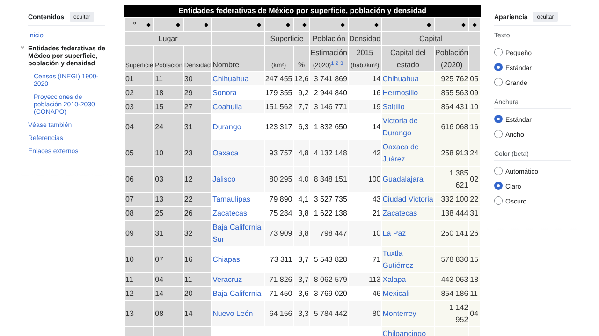

# Práctica 1 · Conectar servidores MCP a un agente

## 1. Descripción

Práctica del Model Context Protocol (MCP): se conectan dos servidores MCP locales
(`filesystem` y `playwright`) a un agente de programación y se resuelven tres actividades
que los combinan, más una cuarta con un servidor elegido libremente (`memory`).

- **Agente / ruta:** Claude Code (Ruta A de la guía). Pasadas 1 y 2: modelo `claude-sonnet-5-5`, en una sesión en la nube (Linux). Pasada 3: Claude Code 2.1.322, modelo `claude-opus-5-5`, en Windows 11 local.
- **Node.js:** v22.23.4 (npm 10.9.9) en la nube; v24.22.1 (npx 11.19.1) en Windows.
- **Servidores:** `@modelcontextprotocol/server-filesystem` 2.2.0, `@playwright/mcp` 0.0.85 (Playwright 1.66 alpha), `@modelcontextprotocol/server-memory`.
- **Fecha de ejecución:** 10 y 12 de noviembre de 2026 (UTC) en la nube; 11 de noviembre de 2026 (hora local, UTC-6) en Windows.

> **Cómo se ejecutó realmente (transparencia).** La práctica se hizo en tres pasadas: las dos primeras en un contenedor sin interfaz gráfica y la tercera en Windows:
>
> 1. **Primera pasada (10 de noviembre):** llamé a las herramientas con un cliente MCP mínimo en Node.js (JSON-RPC 2.0 sobre stdio,
>    el mismo transporte de Claude Code) que lanza los servidores con los comandos de `.mcp.json`. De ahí salen los registros
>    JSON de `evidencias/` y la actividad D.
> 2. **Segunda pasada (12 de noviembre), siguiendo el flujo de la guía con Claude Code 2.1.322:**
>    - `claude mcp list` mostró ambos servidores como *Pending approval* (sección 6.3 de la guía).
>    - Lancé `claude` en un pseudo-terminal en esta carpeta y respondí a los diálogos reales: confianza en la carpeta y
>      «2 new MCP servers found in this project» → *Enable selected*. Resultado: `.claude/settings.local.json` local (no versionado).
>    - `/mcp` mostró **2 servidores: `filesystem` ✔ 14 tools y `playwright` ✔ 25 tools**, y `claude mcp list` los dio como *Connected*.
>    - **Actividades A, B y C** repetidas con las herramientas nativas `mcp__filesystem__*` y `mcp__playwright__*` de la sesión de
>      Claude Code, siguiendo el texto de `instrucciones/`. Los archivos generados (`reporte.md`, `entidades.csv`, captura) quedaron
>      **idénticos** a los de la primera pasada. Navegar a Wikipedia ya no dio 429 con la configuración estándar (`--headless`).
>
> 3. **Tercera pasada (11 de noviembre, hora local), en Windows 11 con Claude Code, usando las herramientas MCP para los archivos:**
>    - `filesystem` no conectaba (`Connection closed`): `.mcp.json` seguía apuntando a `/home/user/...`, que no existe en Windows.
>      Cambié la ruta a `C:/Users/453ri/Servidores-MCP-a-un-agente` con la herramienta de edición propia de Claude Code: fue la única
>      excepción, porque `filesystem` no estaba disponible.
>    - Añadí `memory` con `claude mcp add --scope project` (sección 5). Tras reiniciar la sesión, las herramientas de `filesystem`,
>      `playwright` y `memory` quedaron disponibles en Claude Code.
>    - **Actividad D** ejecutada con las herramientas nativas `mcp__memory__*` (sección 5). Los demás archivos de esta pasada los leí y
>      edité con `mcp__filesystem__*`, este README incluido.
>
> Lo que **no** hice: no pegué cada instrucción en una sesión interactiva anidada (las ejecuté en la propia sesión de Claude Code
> con esos servidores), no hay capturas de la interfaz (decisión de la persona que entrega la práctica), en la tercera pasada no
> repetí las actividades A, B y C, y no probé Antigravity (`.agents/mcp_config.json` conserva la ruta `/home/user/...`).

## 2. Requisitos y reproducción

Requisitos: Node.js ≥ 18 (con `npx`), Google Chrome, Claude Code, Git, conexión a internet.

1. Clona el repositorio y entra en la carpeta.
2. **Cambia la ruta** del servidor `filesystem` en `.mcp.json` (y en `.agents/mcp_config.json` si usas Antigravity)
   por la ruta absoluta de tu copia. En este repositorio `.mcp.json` usa `C:/Users/453ri/Servidores-MCP-a-un-agente`
   (Windows; también en `MEMORY_FILE_PATH` de `memory`) y `.agents/mcp_config.json` usa `/home/user/Servidores-MCP-a-un-agente`.
   Debes sustituirlas.
3. Registro alternativo con comandos (macOS/Linux), dentro de la carpeta:
   ```bash
   claude mcp add --scope project filesystem -- npx -y @modelcontextprotocol/server-filesystem "$PWD"
   ```
   ```bash
   claude mcp add --scope project playwright -- npx -y @playwright/mcp@latest --headless
   ```
   ```bash
   claude mcp add --scope project memory -e MEMORY_FILE_PATH="$PWD/salida/memoria.jsonl" -- npx -y @modelcontextprotocol/server-memory
   ```
   En Windows con Git Bash, `$PWD` da `/c/Users/...`; escribe la ruta como `C:/Users/...`.
4. Ejecuta `claude`, aprueba los servidores del proyecto y comprueba con `/mcp` que están conectados.
5. Pega en el chat cada texto de `instrucciones/actividad_*.txt` y aprueba las llamadas.

Notas de entorno que apliqué al ejecutar aquí (no están en el `.mcp.json` entregado):
`--no-sandbox` y `--executable-path /opt/pw-browsers/chromium` (contenedor sin Chrome del sistema, ejecución como root) y
`--user-agent "practica-mcp-educativa/1.0 (…)"` (ver sección 6).

## 3. Servidores MCP

Configuración en [`.mcp.json`](.mcp.json) (Claude Code) y [`.agents/mcp_config.json`](.agents/mcp_config.json) (Antigravity; validado solo a nivel de archivo y comandos, ver sección 6:
solo copia los mismos comandos). Ambos se lanzan por `stdio` con `npx -y`.

| Servidor | Paquete | Herramientas expuestas (en esta ejecución) |
|---|---|---|
| `filesystem` | `@modelcontextprotocol/server-filesystem` | **14:** `read_file`, `read_text_file`, `read_media_file`, `read_multiple_files`, `write_file`, `edit_file`, `create_directory`, `list_directory`, `list_directory_with_sizes`, `directory_tree`, `move_file`, `search_files`, `get_file_info`, `list_allowed_directories`. Solo dentro de las carpetas indicadas al arrancar. |
| `playwright` | `@playwright/mcp` | **25:** `browser_navigate`, `browser_evaluate`, `browser_snapshot`, `browser_take_screenshot`, `browser_click`, `browser_type`, `browser_close`, `browser_tabs`, `browser_wait_for`, … (lista completa en `evidencias/01_servidores.txt`). |

La guía menciona 16 herramientas para `filesystem`; en mi ejecución fueron 14. Es una diferencia de versión del servidor, no un error de configuración.

Estado de conexión (handshake `initialize` + `tools/list`): [`evidencias/01_servidores.txt`](evidencias/01_servidores.txt).

## 4. Actividades A, B y C

Registros completos de cada llamada: `evidencias/log_actividades_a_c.json`, `log_actividad_b.json`, `log_actividad_b_captura.json`.

### Actividad A: lectura y escritura de archivos (`filesystem`)

Instrucción: [`instrucciones/actividad_a.txt`](instrucciones/actividad_a.txt).

**Secuencia de herramientas:** 1) `list_directory` (`datos` → `[FILE] calificaciones.csv`) → 2) `read_text_file` (`datos/calificaciones.csv`) → 3) `write_file` (`salida/reporte.md`).
El cálculo de promedios lo hizo el cliente en código (el servidor solo lee y escribe).

**Resultado:** [`salida/reporte.md`](salida/reporte.md) con 8 alumnos, 6 aprueban, no aprueban Diego Ruiz (5.50) y Héctor Vega (5.33), promedio del grupo **7.50**. Coincide con lo esperado.
Nota: Carla Méndez y Gabriela Luna empatan en 9.50; el orden entre ellas es el de aparición en el CSV.

### Actividad B: de una página web a un CSV (`playwright` + `filesystem`)

Instrucción: [`instrucciones/actividad_b.txt`](instrucciones/actividad_b.txt).

**Secuencia:** `playwright.browser_navigate` → `playwright.browser_evaluate` (listar tablas; la tabla 0 tiene 35 filas = 3 de encabezado + 32 entidades) →
`playwright.browser_evaluate` (leer filas de muestra e identificar columnas) → `playwright.browser_evaluate` (extraer las 32 filas, limpiando separadores de miles) →
**cambio de servidor:** `filesystem.write_file` (`salida/entidades.csv`) → `playwright.browser_evaluate` (desplazar a la tabla) → `playwright.browser_take_screenshot` → `playwright.browser_close`.

**Cómo obtuvo los datos:** **ejecutando JavaScript** en la página (`browser_evaluate`) sobre el DOM de la tabla, no leyendo un snapshot de accesibilidad.
El agente pasó de `playwright` a `filesystem` solo para escribir el archivo, porque Playwright no escribe en la carpeta del proyecto.

**Resultado:** [`salida/entidades.csv`](salida/entidades.csv): encabezado + **32 filas**; la primera es Chihuahua con 247455 km². La tabla usa la **estimación de población de 2020**; la columna de densidad está rotulada **2015** en la página.

**Captura:** 

**Verificación manual:** comparé con la página tres filas (valores del CSV, coinciden con la captura):
Chihuahua `247455, 3741869, 14` · Jalisco `80295, 8348151, 100` · Ciudad de México `1495, 9209944, 5966`.
Además, hice una comprobación independiente: extraje la tabla del HTML descargado con `curl` y Python (sin Playwright) y las **32 filas coincidieron exactamente**.

### Actividad C: los límites del servidor (`filesystem`)

Instrucción: [`instrucciones/actividad_c.txt`](instrucciones/actividad_c.txt).

**Secuencia:** `list_allowed_directories` → `read_text_file` (`/etc/hosts`) → `list_directory` (`/home/user`, el directorio padre).

**Respuestas textuales del servidor:**
```text
list_allowed_directories → Allowed directories:
/home/user/Servidores-MCP-a-un-agente

read_text_file /etc/hosts → Access denied - path outside allowed directories: /etc/hosts not in /home/user/Servidores-MCP-a-un-agente

list_directory /home/user → Access denied - path outside allowed directories: /home/user not in /home/user/Servidores-MCP-a-un-agente
```

**Quién impuso el límite:** **el servidor.** El modelo/cliente sí envió ambas peticiones; el servidor las rechazó al comparar la ruta con la lista de directorios que recibió como argumento al arrancar.
El host (Claude Code) no interviene en este rechazo (su papel sería pedir aprobación antes de cada llamada). Un límite dentro del servidor no depende de que el modelo obedezca una instrucción del prompt.

## 5. Actividad D: servidor adicional

Instrucción y tarea: [`instrucciones/actividad_d.txt`](instrucciones/actividad_d.txt). Memoria resultante: `salida/memoria.jsonl`.
Registro de la primera pasada (cliente JSON-RPC propio): `evidencias/log_actividad_d.json`. La tercera pasada se describe abajo.

- **Conexión:** `claude mcp add --scope project memory -e MEMORY_FILE_PATH="C:/Users/453ri/Servidores-MCP-a-un-agente/salida/memoria.jsonl" -- npx -y @modelcontextprotocol/server-memory`,
  que lo registra en `.mcp.json`. Después reinicié la sesión de Claude Code para cargarlo.

- **Servidor:** `@modelcontextprotocol/server-memory`, **publicado por el proyecto MCP** (monorepo `modelcontextprotocol/servers`, mantenedores de Anthropic y del proyecto MCP; comprobado con `npm view`).
- **Herramientas (9):** `create_entities`, `create_relations`, `add_observations`, `delete_entities`, `delete_observations`, `delete_relations`, `read_graph`, `search_nodes`, `open_nodes`.
- **Tarea (tercera pasada, herramientas nativas de Claude Code):**
  1. Al arrancar, `read_graph` devolvió el grafo de la primera pasada, cargado de `salida/memoria.jsonl`. Como `create_entities` se salta
     los nombres que ya existen, primero lo vacié con `delete_entities`. El modo automático de Claude Code bloqueó esa llamada por ser
     destructiva; la persona que entrega la práctica la aprobó. Después `read_graph` devolvió un grafo vacío.
  2. `create_entities`: Diego Ruiz (A004, 5.50, No aprueba), Hector Vega (A008, 5.33, No aprueba) y Grupo Practica 1 (7.50, 6 de 8
     aprueban), con los datos de `salida/reporte.md`.
  3. `create_relations`: cada alumno «pertenece a» Grupo Practica 1. Con `filesystem.read_text_file` comprobé que `salida/memoria.jsonl`
     tenía las 5 líneas (3 entidades y 2 relaciones).
  4. Reconecté el servidor (`/mcp` → `memory` → *Reconnect*, proceso nuevo) y `search_nodes("No aprueba")` devolvió a los dos alumnos con
     sus relaciones: **la memoria persiste**.

  El archivo resultante tiene el mismo contenido que el de la primera pasada (git no detecta cambios).
- **Por qué lo considero confiable:** lo publica el mismo proyecto que define el protocolo, el código es abierto, y su alcance es mínimo: no accede a red ni a ejecución de comandos, solo lee/escribe un único archivo `.jsonl` cuya ruta fijo yo con `MEMORY_FILE_PATH`. No requirió ninguna clave. Limitación: confío en que la versión publicada en npm corresponde al código del repositorio; no audité el paquete línea a línea.

## 6. Problemas encontrados

1. **El SDK cliente de MCP no completó el handshake** (timeout en `initialize`, 60 s) con `server-filesystem`. Un `initialize` escrito a mano sí funcionó, así que lo resolví reemplazando el SDK por un cliente JSON-RPC mínimo. No investigué la causa raíz (probable desajuste de versiones de protocolo) [Especulando].
2. **Wikipedia respondió HTTP 429 a Chromium headless** (y 200 a `curl`). Lo resolví enviando un `user-agent` que identifica el uso educativo, como piden las normas de Wikimedia para clientes automatizados. Una sola página, sin crawling.
3. **Primera captura inútil:** mostraba la cabecera del artículo y no la tabla. Lo detecté al abrir la imagen; añadí un `scrollIntoView` a la tabla y repetí la captura.
4. **Mi primera verificación con `curl` fue incorrecta** (comparó texto del artículo, no la tabla). La rehice parseando la tabla y comparando las 32 filas.
5. **Diferencias con la guía:** 14 herramientas de `filesystem` en vez de 16; Chrome del sistema ausente (usé el Chromium preinstalado); `--headless` activo (no se abre ventana).
6. **Ruta B (Antigravity) solo validada a medias:** Antigravity no está disponible en el entorno. Comprobé que `.agents/mcp_config.json` es JSON válido y que cada `command`/`args` arranca su servidor y completa el handshake MCP (`filesystem` 14 herramientas, `playwright` 25). **No** lo cargué dentro de Antigravity: la interfaz y la carga del archivo quedan sin probar. En Windows 11 con Claude Code (tercera pasada), `"command": "npx"` sin `cmd /c` funcionó para los tres servidores; en Antigravity sigue sin probar.
7. **Ruta de Linux en Windows (tercera pasada):** `filesystem` se cerraba al arrancar (`Connection closed`) porque recibía `/home/user/...`, que no existe en Windows. Lo resolví poniendo la ruta de Windows en `.mcp.json` y reiniciando la sesión.

## 7. Fuentes

- Datos de `entidades.csv`: Wikipedia, «Anexo:Entidades federativas de México por superficie, población y densidad», <https://es.wikipedia.org/?curid=5897912> (consultada el 10 de noviembre de 2026; población: estimación 2020).
- Guía de la práctica (Práctica 1, Ingeniería en Sistemas Computacionales).
- Protocolo: <https://modelcontextprotocol.io> · MCP en Claude Code: <https://code.claude.com/docs/en/mcp> · MCP en Antigravity: <https://antigravity.google/docs/mcp>
- Servidores: <https://github.com/modelcontextprotocol/servers> (`filesystem`, `memory`) y <https://github.com/microsoft/playwright-mcp> (`playwright`).
- Registro oficial: <https://registry.modelcontextprotocol.io>
